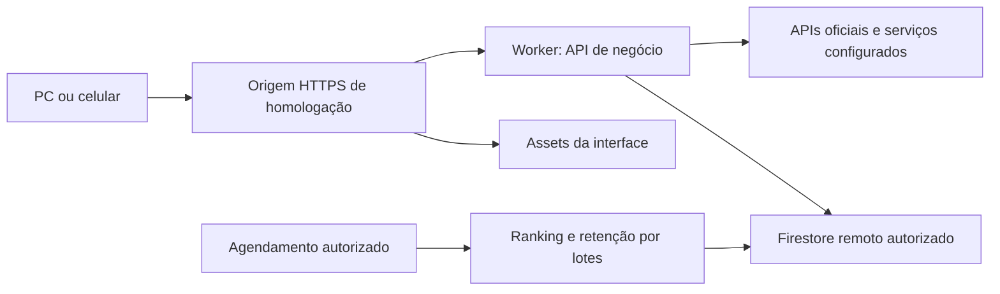

# Etapa 8-A — inventário da integração — 25/10/2026

Status: inventário local e plano concluídos; Etapa8 iniciada. Nenhuma infraestrutura criada, nenhuma leitura/gravação em dados de produção e nenhum deploy. A conclusão desta subetapa não certifica integração remota nem o runtime Workers.

## Escopo e decisões do proprietário

- Iniciar Etapa8 após correção/validação da contenção das leituras públicas.
- Ainda sem domínio próprio: planejar um endereço gratuito de homologação. Nome/disponibilidade e conta Cloudflare não foram verificados; não foi reservado endereço.
- Banco remoto começará vazio de jogos, shorts e comentários; conteúdo definitivo será cadastrado depois. Não migrar os testes locais. Metadados internos de inicialização são necessários e não equivalem a importar conteúdo.
- Preservar integralmente o banco demo8080 e backups locais; nenhum reset ou seed nesta rodada.
- Prioridade a planos gratuitos. Não habilitar faturamento/serviços pagos nem prometer capacidade gratuita ilimitada.
- Deploy, DNS, IAM, credenciais, criação de banco e agendamentos remotos continuam sujeitos a autorização específica e execução controlada. A autorização para iniciar a etapa não implica publicação automática.
- PWA somente na8.5 após integração concluída; auditoria final na9.

## Inventário realmente encontrado

| Camada | Arquivos principais | Estado atual | Preparação necessária |
| --- | --- | --- | --- |
| Interface | src/features/shorts/pages/HomePage.tsx; src/app/router/router.tsx; index.html | React19/Router7, build Vite8 em dist | Servir assets e fallback de rotas sem encaminhar /api para HTML |
| Modo de dados | src/lib/firebase/mode.ts; .env.example | Só demo ou firestore-emulator selecionado por VITE_DATA_MODE | Introduzir modo API remoto explícito, mantendo demo/local seguros; não renomear silenciosamente modo local |
| Repositório público | src/lib/firebase/public-repository.ts; public-read-api.ts | Feed, jogos, detalhes/comentários usam API relativa; cache de catálogo compartilhado | Remover dependência restante da inicialização Firestore local como chave do cache, preservando compartilhamento/invalidação |
| Coordenação de leituras | src/lib/http/public-read-queue.ts; ordered-feed-api.ts | Corrige disputa na mesma aba; servidor ainda valida/conta | Manter e retestar no destino; não interpretar fila local como mutex distribuído |
| Runner HTTPS | scripts/dev-api.mjs; local-api-bridge.mjs | Node+Vite, certificado local, socket, origem5174 | Criar composição própria para o destino; não publicar o runner de desenvolvimento |
| API de negócio | server/http/public-api.ts e handlers | Request/Response, dependências injetadas | Reutilizar contratos, políticas e validações; fornecer origem/configuração/armazenamento confiáveis |
| Persistência | server/firestore/atomic-store.ts; rest-store.ts | REST em demo8080; caminho remoto existe mas exige accessToken não composto no runner | Implementar/validar credencial OAuth de servidor e renovação; separar projeto/banco/ambiente |
| Admin | server/auth/firebase-admin.ts; src/features/admin/services/admin-auth.ts | Auth real clipzone-db02a, Google/TOTP, allowlist de UID; banco continua demo | Provar RS256/Buffer/crypto no runtime; validar domínio de login e configuração por ambiente mantendo privilégios atuais |
| Rede e sessão | server/security/visitor-identity.ts; network-abuse.ts; network-address.ts | Cookie __Host assinado, limites persistidos; IP confiável vem do socket local | Origem canônica, segredos persistentes por ambiente e extração de IP garantida pela borda; não confiar em X-Forwarded-For arbitrário |
| YouTube | server/videos/configured.ts e adaptadores | Chave só no servidor; verificação técnica e incerteza preservadas | Configurar restrições compatíveis com o backend de destino; testar 403/quota/chave ausente sem relaxar publicação |
| Twitch/IGDB | server/games/igdb.ts; server/videos/twitch.ts | OAuth de aplicação, token temporário em memória, catálogo e clipes | Configurar segredos/renovação e limites sem pressupor memória compartilhada entre instâncias |
| TikTok | adaptadores em server/videos/ | oEmbed/links reduzidos e verificações já existentes | Testar egress/redirecionamentos permitidos sem conceder confiança a destinos arbitrários |
| Tradução opcional | server/games/translate-description.ts; translation-store.ts | Workers AI via REST, flag e orçamento local, fallback | Decidir ativação/orçamento remoto; manter desligada se não configurada, sem falhar catálogo |
| Capas manuais externas | server/games/remote-cover.ts; edit-manual-game.ts | DNS público, IP pinado, TLS, limites de bytes/dimensões/redirects | Prova crítica: Node DNS lookup e socket/TLS não são equivalentes no Workers; preservar defesa antes de habilitar |
| Ranking | server/ranking/generation.ts; bootstrap.ts; scripts/local-ranking.mjs | Geração por snapshot/lease e publicação completa; temporizador Node | Entrada agendada real com orçamento/checkpoints; não copiar setTimeout permanente |
| Retenção | server/security/network-retention.ts; scripts/local-network-retention.mjs; server/likes/retention.ts | Rede limpa lotes; likes tem manutenção explícita; demais retenções precisam política | Definir jobs com limites, idempotência, monitoramento e retenção sem eliminar registros de negócio |
| Regras/índices | firestore/firestore.rules; firestore.indexes.json; docs/title-search.indexes.dormant.json | Arquivos locais; regras negam escrita cliente/coleções privadas e permitem jogos ativos | Revisar/aplicar apenas em alvo autorizado; busca por título continua dormente |
| Testes | tests/*.test.mjs; tests/firestore/*.test.mjs | Regressões unitárias/HTTP/SSR e emulador isolado8081 | Acrescentar provas específicas de runtime, credenciais e isolamento sem repetir suítes sem necessidade |

package.json não contém Wrangler ou plugin Cloudflare; node_modules/.bin/wrangler.cmd ausente. Nenhum wrangler config ou entrada Worker encontrado. tsconfig.server usa tipos Node; build TypeScript atual não é prova de compatibilidade com Workers. Não instalei ferramentas/dependências.

## Arquitetura candidata

Recomendação técnica provisória: Workers com Static Assets para dist e /api no mesmo domínio, mantendo a API Request/Response. Essa escolha reduz separação de origens e preserva chamadas relativas/cookies; depende das provas abaixo, não está aprovada como solução já compatível. README ainda registra Pages/Functions como intenção histórica; não há implantação existente confirmada para migrar.

Workers oferece configuração de assets e fallback SPA; rotas /api precisam precedência explícita para que navegação direta não receba index.html indevidamente. Proposta: roteamento API primeiro só onde necessário, sem invocar código de negócio para todo asset. Referências: [routing](https://developers.cloudflare.com/workers/static-assets/routing/worker-script/), [SPA](https://developers.cloudflare.com/workers/static-assets/routing/single-page-application/).

Nenhum nome de Worker, workers.dev, domínio, binding ou recurso remoto foi criado.

## Provas que precedem a conexão remota

### 1. Capas externas: incompatibilidade identificada

O código atual usa dns.promises.lookup e https.request com lookup personalizado para fixar IP. A documentação Workers informa que lookup não é implementado, e que node:https usa fetch sem acesso ao socket/TLS específico. Portanto, habilitar compatibilidade Node não basta para assegurar essa defesa. Referências: [DNS](https://developers.cloudflare.com/workers/runtime-apis/nodejs/dns/) e [HTTPS](https://developers.cloudflare.com/workers/runtime-apis/nodejs/https/).

8-B deve provar um adaptador com proteção equivalente, preservando URLs permitidas e funções existentes. Se não for possível, apresentar alternativa de runtime/componente e seu impacto para decisão do proprietário. Não substituir por fetch irrestrito, desativar a validação, esconder a falha ou remover a funcionalidade sem aprovação. Nem Pages Functions evita, por si, limitações do runtime Workers.

### 2. Orçamento por invocação e ranking

Na documentação consultada, Workers Free tem50subrequests por requisição e10ms de CPU; latência de rede não conta como CPU. Precisa medir, não inferir compatibilidade a partir do tempo total Node. [Limites oficiais](https://developers.cloudflare.com/workers/platform/limits/).

readOrderedFeed resolve até30candidatos com leituras de short/jogo e queries, além da transação de proteção e eventual OAuth: casos de muitos jogos ocultos/distintos podem superar50chamadas externas. Geração de ranking permite até762leituras/124escritas por rodada e também não pode ser transferida integralmente sem dimensionar invocações. Essas são análises do código/limites, não testes já executados no Workers.

As provas devem cobrir o pior lote, transações com retentativa, autorização administrativa, assinatura de tokens e jobs. Se precisar agrupar batchGet ou dividir jobs, preservar a semântica, o snapshot, a checagem de visibilidade, leases e publicação atômica; não reduzir resultados ou pular validações silenciosamente. Jobs devem usar scheduled/Cron quando aprovados, com limites próprios: [scheduled](https://developers.cloudflare.com/workers/runtime-apis/handlers/scheduled/).

### 3. Credenciais remotas e ambiente

createRestStore já suporta OAuth, mas nenhum fornecedor de token de produção está composto. A documentação Firestore distingue ID token de usuário de token OAuth de serviço: com OAuth, IAM autoriza e as Security Rules não são a barreira para esse acesso. Implementar privilégio mínimo e validações servidor; não usar Bearer owner fora do emulador. [REST Firestore](https://firebase.google.com/docs/firestore/use-rest-api).

Escolher forma de credencial e renovação antes de criar permissões. Não solicitar chave privada pelo chat; não colocar tokens/JSON de serviço em VITE_*, frontend, Git ou logs. Configuração Firebase Auth pública não é a credencial de banco. Guardar segredos no mecanismo do ambiente: [Workers secrets](https://developers.cloudflare.com/workers/configuration/secrets/).

Não consultei a conta Cloudflare, plano atual, banco remoto, região, índices aplicados, quotas reais ou recursos do projeto Auth. clipzone-db02a é apenas o alvo de Auth existente no código; não inferir que seu Firestore já existe ou foi liberado.

## Configuração: somente nomes, nunca valores

| Grupo | Configuração existente ou a definir | Regra |
| --- | --- | --- |
| Origem | Origem canônica por ambiente, futura configuração | Rejeitar origem externa; nada fixo5174 no destino |
| Banco | projectId/database alvo + fornecedor accessToken | Alvos explícitos; homologação e produção separados; local não muda |
| Auth público | FIREBASE_AUTH_API_KEY, FIREBASE_AUTH_APP_ID; projectId/authDomain atuais | Pode ser entregue por /api/admin/config; sem privilégio embutido |
| Admin privado | CLIPZONE_ADMIN_UIDS | Segredo/configuração só no servidor; Google+TOTP permanecem obrigatórios |
| Identidade/rede | Chaves visitor e network hoje em .env.security.local | Novas chaves persistentes do ambiente; não gerar por request/deploy nem copiar automaticamente segredos locais |
| Twitch/IGDB | TWITCH_CLIENT_ID, TWITCH_CLIENT_SECRET | Servidor; token OAuth renovável e escopo mínimo |
| YouTube | YOUTUBE_API_KEY | Servidor; restrições e quotas adequadas ao runtime; não presumir IP fixo ou resolução automática no deploy |
| Tradução | CLIPZONE_TRANSLATION_ENABLED; CLOUDFLARE_ACCOUNT_ID; CLOUDFLARE_AI_TOKEN | Opcional; orçamento e permissões aprovados separadamente |
| Certificado local | LOCAL_TLS_CERT/LOCAL_TLS_KEY | Exclusivamente local; não carregar no Worker |
| Build | VITE_DATA_MODE | Separar modo local/API sem segredos nem endpoint remoto implícito |

Não li .env.server.local ou .env.security.local. Nomes acima vieram de código/example; nenhum segredo foi copiado.

## Banco vazio e preservação

Conteúdo de teste não será migrado. O banco remoto, quando autorizado, precisa de preparação mínima de metadados: gameNameState/v1 e estado de ranking/bootstrap, regras/índices e contadores conforme as funções existentes. Sem isso, inclusão manual/ranking podem ficar indisponíveis mesmo com banco criado. IDs/counters devem começar no próprio ambiente; não importar reservas e identidades locais por conveniência.

As ferramentas scripts/prepare-* atuais têm salvaguardas locais. Não substituir projectId/host para fazê-las atingir produção. Projetar procedimento remoto revisável com alvo explícito, dry-run, pós-condições e autorização antes de gravar. Não usar seed de fixtures no alvo remoto.

Manter backups locais existentes; não chamar export/reset só para este inventário. Backup remoto e restauração precisam de política própria. Firestore fornece cotas gratuitas diárias, mas TTL, backups gerenciados, PITR/restauração e outros recursos listados podem exigir faturamento. Não ativar nada disso automaticamente: [quotas e recursos](https://firebase.google.com/docs/firestore/quotas).

## Homologação e critérios finais

- Homologação remota é um ambiente de teste isolado, não sinônimo de deploy público autorizado. Endereço temporário, conta, acesso e duração serão aprovados antes da publicação.
- Assets com cache apropriado a nomes versionados; API/auth/respostas privadas fora de cache compartilhado. Não incluir dados de sessão nos logs.
- Preservar CSP/referrer necessários a players/login; não adicionar cabeçalho que quebre iframe/OAuth sem ensaio.
- Twitch usa parent a partir do hostname; YouTube usa origin. Validar origem final, HTTPS, controles400×300 e links externos no novo endereço. Não alterar YouTube/TikTok sem necessidade.
- Administração exige token válido, UID autorizado e TOTP também no destino; alterações em domínio/IAM não fazem autoaprovação de contas.
- Desconectar USB e fechar Chrome do PC não devem afetar homologação remota; testar no celular por internet comum após o deploy autorizado.
- Saúde dos jobs, quota, erro de provedor, prontidão de ranking e restauração precisam ser observáveis; logs não devem conter cookies, tokens, IP bruto ou dados de comentários desnecessários.

## Verificação desta subetapa

Leitura de código/configurações, Git limpo na entrada, documentação oficial consultada e diff-check documental. Sem teste completo, novo Lighthouse, build, consulta ao banco, login em conta externa ou operação de infraestrutura: não houve mudança de aplicação que justificasse repetir esses testes nesta8-A.

Próxima subetapa:8-B — provas locais de runtime e composição do backend, sem produção. Dependências de ferramenta não instaladas; propor e justificar eventual ferramenta de teste Workers antes de instalá-la. Planejamento completo em [etapa-8-plano-integracao.md](etapa-8-plano-integracao.md).

## Evidência posterior da 8-B — 25/10/2026

Consultar [provas locais e limitações](etapa-8-b-runtime-api.md). A alegação documental de lookup indisponível não se reproduziu literalmente em workerd1.20261019.1: consulta ao domínio reservado retornou queryA ENOTFOUND. O transporte atual de capas, porém, falhou concretamente em maxHeaderSize não implementado, sem remover opções de proteção. Não confundir essa divergência DNS com equivalência de IP/TLS. Orçamento do feed agora medido em20/34/65 chamadas REST conforme cenário; a hipótese de exceder50 foi confirmada no pior caso simulado. Wrangler instalado apenas fora do repositório mediante autorização expressa, com14 checks locais e deployReady=false. Nenhuma composição remota/infraestrutura criada.
